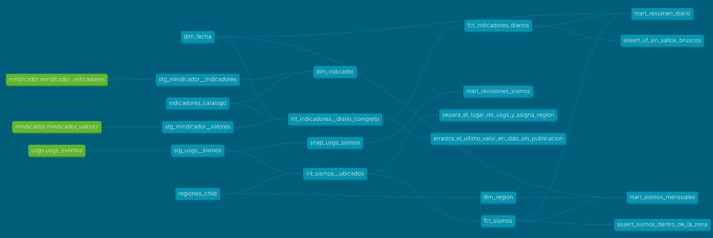
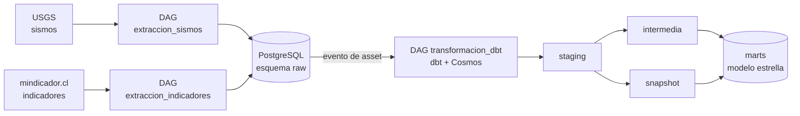
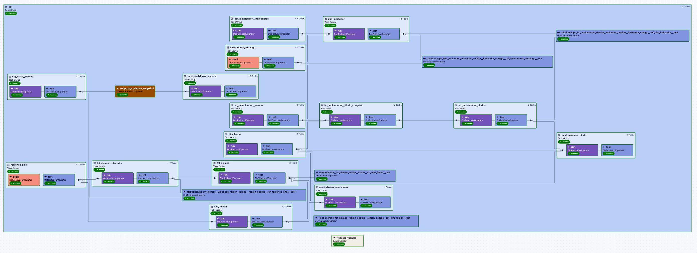

# orquestacion-airflow-dbt

[](https://github.com/sebakine/orquestacion-airflow-dbt/actions/workflows/ci.yml)


Pipeline ELT orquestado con **Apache Airflow 3** y transformado con **dbt**, sobre datos públicos
de Chile: los sismos del catálogo de la [USGS](https://earthquake.usgs.gov/fdsnws/event/1/) y los
indicadores económicos de [mindicador.cl](https://mindicador.cl) (dólar, euro, UF, UTM y cobre).

Es la evolución de [etl-datos-chile](https://github.com/sebakine/etl-datos-chile): allá un solo
script extraía, transformaba y cargaba; acá cada etapa tiene su herramienta.

- **Airflow** decide *cuándo* y *qué* se ejecuta: reintentos, backfills, ejecución por intervalos
  de datos y un DAG de dbt que se dispara solo cuando llegan datos nuevos.
- **dbt** decide *cómo* se transforma: capas staging, intermedia y marts, 56 tests de datos,
  2 tests unitarios, un snapshot que guarda el historial de revisiones y un modelo incremental.

**Documentación de dbt con el grafo de linaje navegable:**
[sebakine.github.io/orquestacion-airflow-dbt](https://sebakine.github.io/orquestacion-airflow-dbt/)



## Arquitectura



1. **Extraer y cargar (EL)**: los DAGs de extracción guardan las respuestas de las APIs en el
   esquema `raw` como JSONB, sin transformarlas. La carga es idempotente: un sismo solo se
   reemplaza si la USGS publicó una versión más nueva (`updated`), y un valor de indicador solo
   si cambió.
2. **Avisar**: cada DAG de extracción publica un evento sobre un *asset* de Airflow
   (`raw/usgs_eventos` o `raw/mindicador_valores`) con cuántas filas insertó o actualizó.
3. **Transformar (T)**: `transformacion_dbt` no tiene horario; se ejecuta cuando cualquiera de
   esos dos assets cambia. [Cosmos](https://github.com/astronomer/astronomer-cosmos) convierte
   cada modelo de dbt en una tarea de Airflow, con sus tests justo después.

## Los DAGs



| DAG | Horario | Qué hace |
|---|---|---|
| `extraccion_sismos` | todos los días a medianoche (Santiago) | Descarga los sismos del intervalo de datos, más 7 días hacia atrás para recoger revisiones de magnitud. Soporta backfill. |
| `extraccion_indicadores` | todos los días a las 10:00 | Una tarea mapeada por indicador (`.expand`), máximo 2 a la vez para no saturar la API. Si una falla, se reintenta solo esa. |
| `transformacion_dbt` | cuando cambia `raw/usgs_eventos` **o** `raw/mindicador_valores` | Revisa la frescura de las fuentes y corre `dbt build` modelo por modelo. |

Todas las tareas tienen 3 reintentos con espera exponencial. Los DAGs usan la API nueva
`airflow.sdk` de Airflow 3.

### Backfill

El DAG de sismos trabaja con intervalos de datos reales (`CronDataIntervalTimetable`): la
ejecución del 10 de octubre carga exactamente los sismos de ese día. Por eso se puede reprocesar
cualquier rango del pasado:

```bash
make backfill DESDE=2025-01-01 HASTA=2025-01-31
```

Como la carga es idempotente, repetir un backfill no duplica nada.

## Los modelos de dbt

| Capa | Esquema | Modelos | Para qué |
|---|---|---|---|
| Fuentes | `raw` | 3 tablas | Lo que cargó Airflow, con chequeo de frescura. |
| Staging | `staging` | `stg_usgs__sismos`, `stg_mindicador__valores`, `stg_mindicador__indicadores` | Saca los campos del JSON, tipa y renombra. Una vista por fuente. |
| Intermedia | `intermedia` | `int_sismos__ubicados`, `int_indicadores__diario_completo` | Lógica de negocio: asigna la región de Chile a cada sismo y completa los fines de semana con el último valor publicado. |
| Marts | `marts` | `dim_fecha`, `dim_region`, `dim_indicador`, `fct_sismos`, `fct_indicadores_diarios`, `mart_sismos_mensuales`, `mart_resumen_diario`, `mart_revisiones_sismos` | Modelo estrella y tablas listas para un dashboard. |
| Snapshot | `snapshots` | `snap_usgs_sismos` | Historial de cambios (SCD tipo 2): cada vez que la USGS revisa la magnitud de un sismo queda una versión nueva. |
| Seeds | `referencia` | `regiones_chile`, `indicadores_catalogo` | Datos fijos versionados en Git. |

Algunas piezas que vale la pena mirar:

- **`fct_sismos` es incremental** (`merge` por `sismo_id`) y tiene **contrato**: si una columna
  cambia de tipo, dbt falla en vez de romper a quien consume la tabla. Filtra por
  `cargado_en` y no por la fecha de actualización de la USGS, porque las revisiones pueden llegar
  con fechas fuera de orden.
- **`mart_revisiones_sismos`** sale del snapshot: muestra cuántas veces se revisó cada sismo y
  cuánto cambió su magnitud.
- **`int_indicadores__diario_completo`** rellena los días sin publicación (fines de semana,
  feriados) con el último valor, pero con un tope por indicador (`dias_arrastre`) para no
  inventar datos si la fuente deja de publicar.
- **Tests**: genéricos de dbt, tests genéricos propios (`en_rango`, `no_futuro`,
  `combinacion_unica`), tests singulares (la UF no puede saltar más de 0,5 % en un día; todos los
  sismos están dentro de la zona consultada) y 2 **tests unitarios** con datos de entrada fijos.

## Cómo probarlo

Necesitas Docker con Compose. Todo corre en tu computador: PostgreSQL, Airflow y dbt.

```bash
git clone https://github.com/sebakine/orquestacion-airflow-dbt.git
cd orquestacion-airflow-dbt
echo "AIRFLOW_UID=$(id -u)" > .env     # solo en Linux
docker compose up -d --build           # o: make up
```

La primera vez tarda unos minutos en construir la imagen. Después:

1. Abre [http://localhost:8080](http://localhost:8080) (en local entra sin contraseña).
2. Activa los tres DAGs y ejecuta `extraccion_indicadores` y `extraccion_sismos` con el botón
   *Trigger*.
3. Cuando terminen, `transformacion_dbt` arranca solo. Abre su vista *Graph* para ver cada modelo
   y sus tests.
4. Mira el resultado:

```bash
docker compose exec postgres psql -U warehouse -d warehouse -c "
  select fecha, dolar, euro, uf, sismos, magnitud_maxima
  from marts.mart_resumen_diario
  order by fecha desc
  limit 7"
```

Para detenerlo: `docker compose down` (los datos quedan en el volumen `pgdata`;
`docker compose down -v` los borra).

## Calidad

```bash
make lint        # ruff y mypy estricto
make test        # extracción y dbt de punta a punta (necesita PostgreSQL y dbt)
make test-dags   # valida los DAGs dentro de la imagen de Airflow
```

- **Tests de Python** (pytest, 98 % de cobertura): extracción con respuestas HTTP simuladas,
  carga idempotente contra PostgreSQL real y un test de punta a punta que carga datos reales
  guardados en `tests/fixtures`, corre `dbt build`, simula una revisión de la USGS (un sismo M6.1
  que pasa a M6.3), vuelve a correr dbt y comprueba que el snapshot guardó las dos versiones y que
  el modelo incremental tomó la nueva magnitud.
- **Tests de DAGs**: cargan los DAGs en un `DagBag` real dentro de la imagen y revisan que no
  haya errores de importación, que los reintentos estén configurados, que la transformación
  dependa de los assets correctos y que Cosmos haya generado una tarea por modelo.
- **CI** en GitHub Actions: lint, tests contra un PostgreSQL de servicio, construcción de la
  imagen de Airflow con los tests de DAGs, y publicación de la documentación de dbt en
  GitHub Pages en cada push a `main`.

## Decisiones de diseño

- **ELT en vez de ETL**: se guarda el JSON crudo y se transforma en SQL. Si mañana cambia una
  regla de negocio, se vuelve a correr dbt sin volver a llamar a las APIs.
- **Scheduling por assets** en vez de horarios fijos encadenados: dbt corre cuando hay datos
  nuevos, no "a las 10:30 por si acaso". El evento de indicadores se emite una sola vez al final,
  no una vez por indicador, para no disparar dbt cinco veces.
- **dbt en su propio entorno virtual** dentro de la imagen: Airflow y dbt tienen dependencias que
  chocan; separarlos es lo que recomienda Cosmos.
- **Cosmos** en vez de un `BashOperator` con `dbt build`: si falla un modelo se ve cuál en la
  interfaz de Airflow y se reintenta solo ese.
- **Un paquete Python (`src/extraccion`)** con la lógica de extracción, separado de los DAGs: se
  prueba sin Airflow y los DAGs quedan cortos.
- **Fechas en UTC en la base y en hora de Chile en los marts**: los sismos se guardan en UTC y la
  macro `fecha_chile` los convierte al día calendario chileno.

## Estructura

```text
dags/                    # DAGs de Airflow
├── comun.py             # conexión, assets, reintentos por defecto
├── extraccion_sismos.py
├── extraccion_indicadores.py
└── transformacion_dbt.py
src/extraccion/          # extracción y carga a raw (Python puro, sin Airflow)
dbt/                     # proyecto dbt
├── models/{staging,intermediate,marts}
├── snapshots/  seeds/  macros/  tests/
docker-compose.yml       # PostgreSQL + Airflow (api-server, scheduler, dag-processor)
Dockerfile               # Airflow 3.4 + Cosmos + dbt en un venv aparte
tests/                   # pytest
```

## Licencia

[MIT](LICENSE) © Sebastián Muñoz
